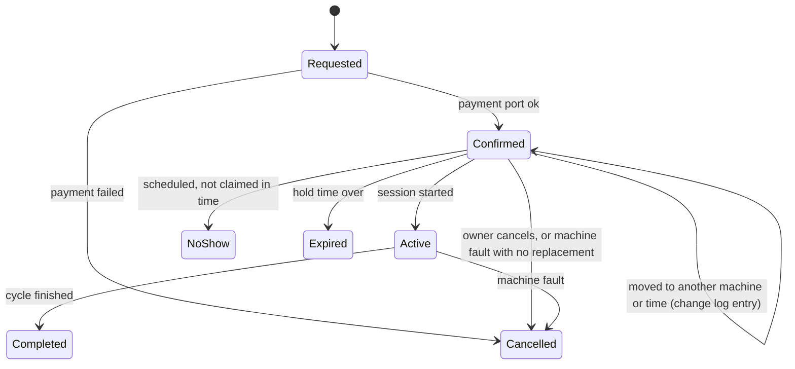
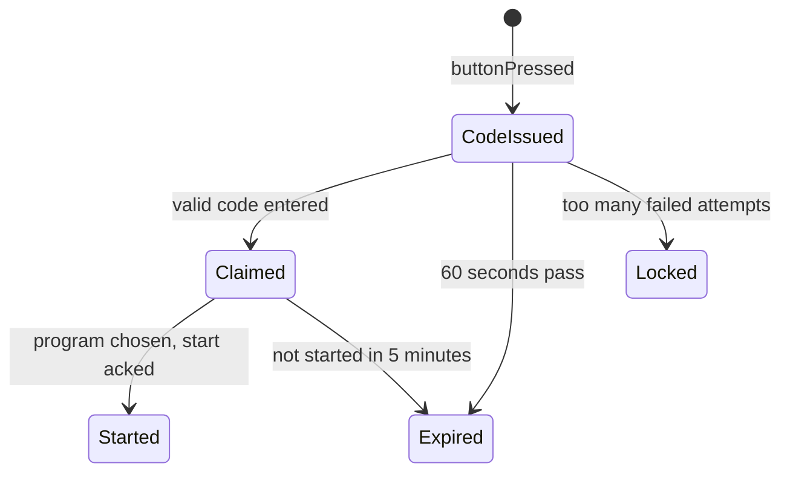
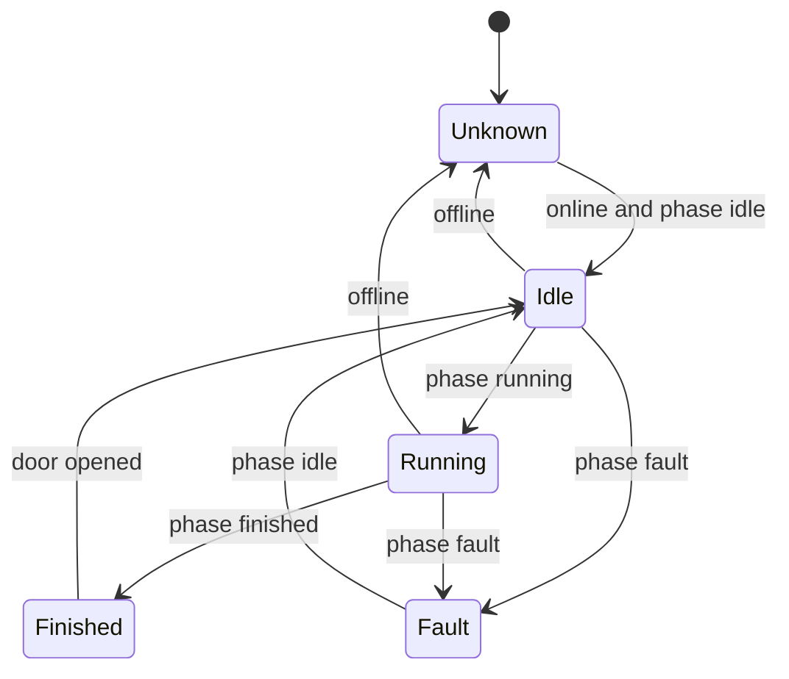
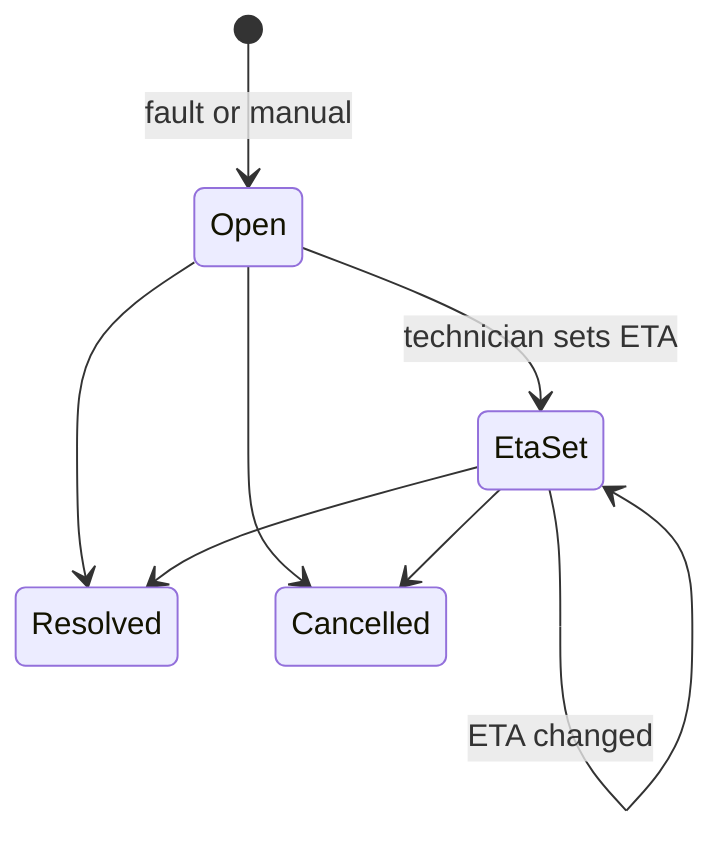
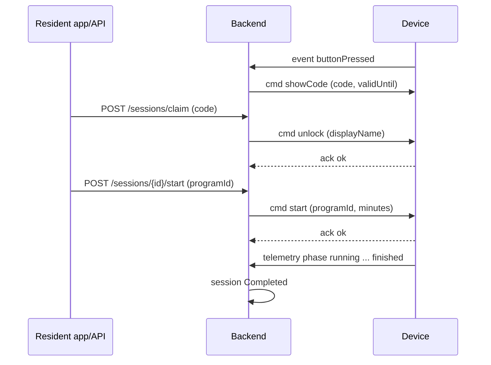
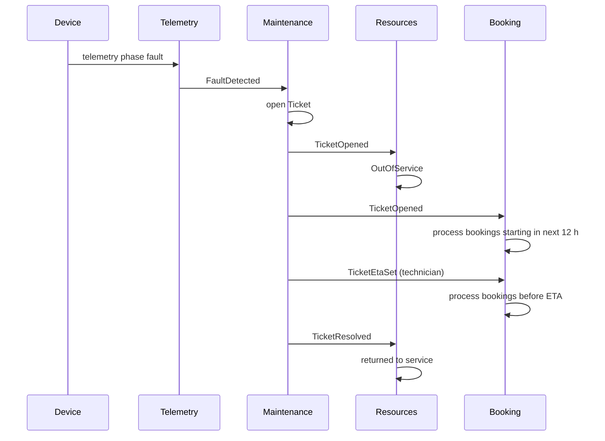

# State machines and key sequences (Mermaid)

## Booking

## Session request (code)

## Machine cycle (Telemetry)

## Ticket

## Resource operational state (derived for availability)
| Condition (first match wins) | State |
|---|---|
| OutOfService flag set | OutOfService |
| cycle phase running, or Active booking | InUse |
| a Hold or a Scheduled booking covers now (or starts within the claim window) | Reserved |
| otherwise | Available |

Cycle state Unknown adds `offline: true` to the availability item; the machine cannot be started until it is online.

## Session start (UC-08)

## Fault and rescheduling (UC-05)

